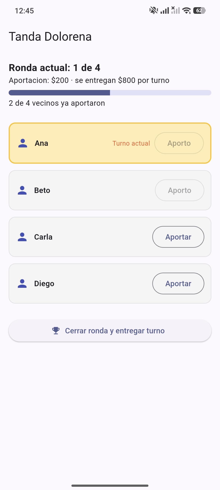
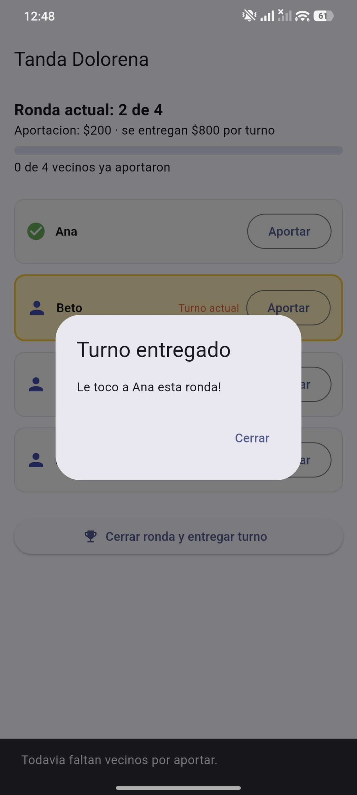
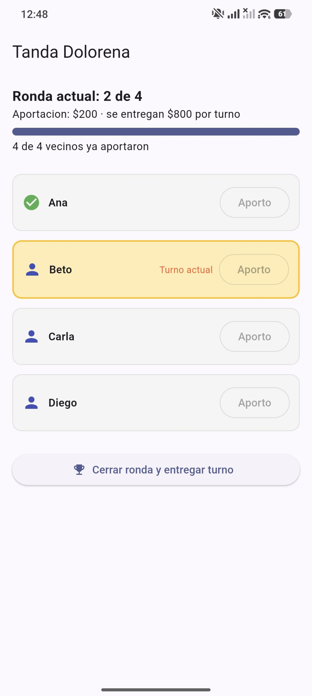
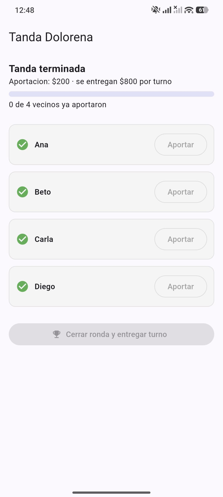
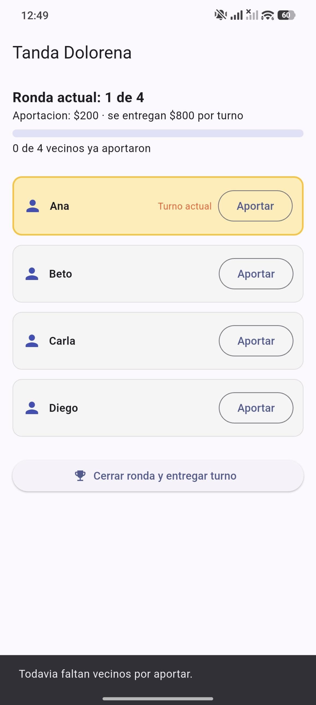

# Tanda Doloreña — ahorro rotativo vecinal con TDD

App Flutter que lleva el control de una **tanda** entre vecinos de Dolores Hidalgo: quién ya aportó en la ronda, cuándo se puede cerrar y a quién le toca recibir el dinero, con animaciones al entregar el turno. Construida con **TDD (Rojo → Verde → Refactor)** siguiendo el *Manual paso a paso con TDD — Tanda Doloreña*.

**Reglas protegidas con pruebas:** cada vecino aporta máximo una vez por ronda · solo aportan participantes reales · la ronda se cierra solo cuando todos aportaron · el turno sigue el orden acordado · al terminar ya no se aceptan aportaciones. **Reto del manual:** barajar el orden de turnos antes de empezar.

---

## 📦 APK

| Archivo | Ruta |
|---|---|
| Lista para instalar | `apk/TandaDolorena.apk` (43.6 MB) |
| Salida de Flutter | `build/app/outputs/flutter-apk/app-release.apk` |

```bash
flutter build apk --release --target-platform android-arm64
```

El APK es para teléfonos **arm64** (prácticamente todos los Android de los últimos años). Para instalar: copia el `.apk` al teléfono, ábrelo y acepta *instalar apps de origen desconocido*.

---

## 🏗️ Estructura

```text
lib/
├── modelos/        participante · tanda · cierre_ronda           (Dart puro)
├── logica/         servicio_tanda · resultado_aportacion · resultado_cierre
├── presentation/   tanda_screen.dart  (solo dibuja y le pregunta a ServicioTanda)
└── main.dart
test/
├── servicio_tanda_test.dart   (rondas 1-7, reto de barajar e integración)
└── tanda_screen_test.dart     (pruebas de widget)
```

---

## 🔴🟢🔵 Evidencia del ciclo TDD

### 1. 🔴 ROJO — las pruebas se escriben primero y fallan

Las pruebas de `test/` se escribieron **antes** que el código. `flutter test` falla porque `lib/modelos/...` y `lib/logica/...` todavía no existen.

### 2. ❌ Error real atrapado por una prueba

La pantalla se escribió **tal cual el manual**. Para saber quién tiene el turno, el manual hace:

```dart
final esTurnoActual = _tanda.ordenTurnos[_tanda.turnoActual] == participante.id;   // ❌
```

Después de entregar el último turno, `turnoActual` vale 4 y la lista solo tiene índices 0..3. La prueba de widget *"la pantalla no truena cuando la tanda termina"* juega las 4 rondas completas y atrapó el `RangeError` (en el teléfono habría salido la pantalla roja de error).

**Corrección:** la pantalla ya no indexa la lista; le pregunta al servicio, que devuelve `null` cuando la tanda terminó (con su propia prueba de dominio):

```dart
Participante? beneficiarioActual() {
  if (haTerminado()) return null;
  final id = tanda.ordenTurnos[tanda.turnoActual];
  return tanda.participantes.firstWhere((p) => p.id == id);
}

final esTurnoActual = beneficiario?.id == participante.id;   // ✅
```

Además, al terminar se muestra **"Tanda terminada"**, se deshabilitan los botones y `cerrarRondaYAvanzar()` devuelve `ResultadoCierre.tandaYaTermino` (en el manual ese valor existía pero nunca se usaba).

### 3. 🔵 REFACTOR — limpiar sin romper nada

Las condiciones de `registrarAportacion()` se nombraron como reglas de negocio (Ronda 8) y `flutter analyze` quedó sin avisos.

### 4. 🟢 VERDE — las 21 pruebas pasan

Las 21 pruebas del proyecto pasan tras completar el ciclo de desarrollo y correcciones.

### 5. 📦 Compilación del APK

El APK de liberación se compila en modo `release` para `android-arm64`.

---

## ✅ Qué cubren las pruebas

| Grupo | Lo que se verifica |
|---|---|
| Aportaciones | registrar, rechazar repetida, rechazar a quien no es participante (sin modificar la ronda) |
| Cierre de ronda | `puedeCerrarRonda`, beneficiario según el **orden acordado** (no por quién aportó primero), no cerrar con faltantes, monto = aportación × participantes |
| Fin de la tanda | `haTerminado`, no aceptar aportaciones ni cierres después, `beneficiarioActual` = `null` |
| Reto: barajar | el orden barajado conserva a todos una sola vez; no se puede barajar una tanda iniciada |
| Integración | 3 vecinas completan la tanda: beneficiarios `p1, p2, p3` |
| Pantalla | ronda 1 de 4, aviso de faltantes, revelación animada del beneficiario, **no truena al terminar** |

```bash
flutter test
```

---

## 📱 Capturas de la app

> Tomadas en un teléfono físico con el APK instalado. *Guarda tus capturas en `capturas/` con estos nombres y aparecerán aquí automáticamente.*

| Inicio (ronda 1) | Vecinos aportando | Turno entregado (animación) |
|---|---|---|
|  |  |  |

| Ronda 2 (turno de Beto) | Tanda terminada | Error: cerrar con faltantes |
|---|---|---|
|  |  |  |

### Qué probar en la app

| Caso | Qué hacer | Resultado esperado |
|---|---|---|
| Aportar | Toca "Aportar" en un vecino | El botón cambia a "Aporto" y sube la barra |
| Cerrar incompleta | "Cerrar ronda" con alguien sin aportar | SnackBar "Todavia faltan vecinos por aportar." |
| Entregar turno | Aportan los 4 y cierras | Diálogo animado "Le toco a Ana esta ronda!" |
| Orden | Repite las rondas | Ana → Beto → Carla → Diego |
| Fin | Después de la ronda 4 | "Tanda terminada" y botones deshabilitados |

---

## 🛠️ Cómo correr el proyecto

```bash
flutter pub get
```

```bash
flutter test
```

```bash
flutter run
```
